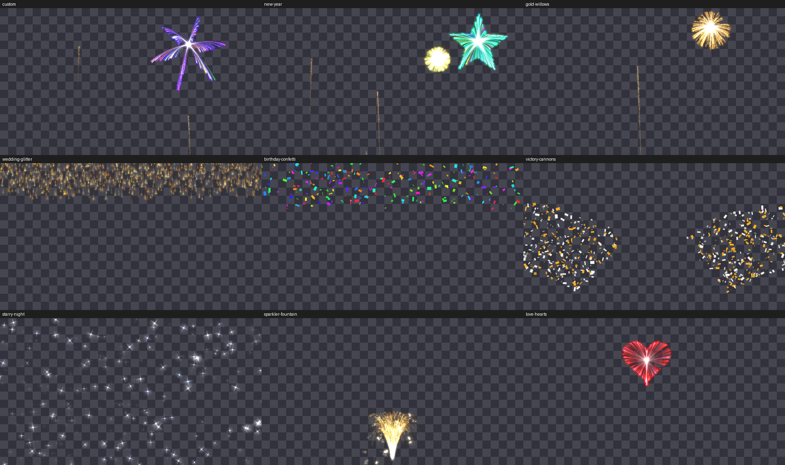

# Sparkles for Resolume

An FFGL 2 **source** plugin for Resolume Arena and Avenue that generates
fireworks, sparkles, confetti, fountains and glitter. It renders over a
**transparent background**, so you can put it on a layer above your other
content as a celebration overlay, or switch the background to black and use it
on its own.



- 7 effects: Fireworks, Bursts, Sparkles, Confetti Rain, Confetti Cannon,
  Fountain, Glitter Rain
- 8 explosion shapes: Peony, Ring, Willow, Palm, Heart, Star, Crackle, Random
- 9 palettes, including two colour pickers for brand or team colours
- 8 one-click presets for common events
- A **Burst** button you can map to a key or MIDI pad, beat sync to Resolume's
  BPM, and an audio trigger that fires on bass hits
- Windows (x64) and macOS (universal: Apple Silicon and Intel)

## Installing

Quit Resolume first: it only scans for plugins at launch.

### macOS: the installer

Download `sparkles-<version>-macos.pkg` from the
[Releases](https://github.com/legofsalmon/ffglsparkles/releases) page (or the
`sparkles-macos-pkg` artifact of any CI run), double-click it, and tick Arena,
Avenue or both. It installs into your own Documents folder, so it needs no
administrator password.

Use the installer rather than copying the bundle by hand. A bundle extracted
from a downloaded zip carries macOS's quarantine flag, and Resolume silently
refuses to load it; the installer delivers it without the flag.

Until the package is signed (see [Releases](#releases)), macOS will say it is
from an unidentified developer the first time: Control-click the .pkg, choose
**Open**, then **Open** again.

### Windows, or by hand

1. Download `Sparkles.dll` (Windows) or `Sparkles.bundle` (macOS), or build it
   (below).
2. Copy it into Resolume's FFGL folder:
   - Windows: `Documents\Resolume Arena\Extra Effects\`
   - macOS: `~/Documents/Resolume Arena/Extra Effects/`, then in Terminal
     `xattr -dr com.apple.quarantine ~/Documents/Resolume\ Arena/Extra\ Effects/Sparkles.bundle`

   Or point Resolume at another folder under *Preferences → Video → FFGL plugin
   folders*.

Restart Resolume. **Sparkles** appears in the *Sources* tab alongside the other
generators. Drag it into a clip slot like any other generator.

To overlay: put the clip on a layer above your content. The layer's blend mode
can stay on its default; the plugin outputs premultiplied alpha, so anything
without particles is see-through.

## Parameters

Parameters are grouped into collapsible sections (Resolume 7.3 and later).
Controls that do nothing for the current effect are hidden.

### Preset

| Parameter | What it does |
| --- | --- |
| **Preset** | Writes a complete look in one go. Every Emitter, Position, Colour, Motion and Look parameter is set, either to the preset's value or back to its default, so presets never inherit half of the previous look. Anything you change afterwards is kept. Audio and Output settings, and your colour pickers (except where a preset brings its own pair), are left alone. |

| Preset | Effect | Notes |
| --- | --- | --- |
| New Year | Fireworks | Random shapes, rainbow, busy |
| Gold Willows | Fireworks | Slow drooping gold willows, long trails |
| Wedding Glitter | Glitter Rain | Gold, heavy twinkle |
| Birthday Confetti | Confetti Rain | Rainbow paper across the whole frame |
| Victory Cannons | Confetti Cannon | Colour A + B: sets white and gold, change them to team colours |
| Starry Night | Sparkles | Silver glints over the whole frame |
| Sparkler Fountain | Fountain | Gold gerb from the bottom centre |
| Love Hearts | Bursts | Heart-shaped bursts in pink and red |

### Emitter

| Parameter | Range | What it does |
| --- | --- | --- |
| **Effect** | list | What is emitted. *Fireworks*: rockets rise from the bottom and burst. *Bursts*: explosions appear in place, no rocket. *Sparkles*: twinkling four-point glints scattered over an area. *Confetti Rain*: paper falling from the top. *Confetti Cannon*: paper fired up from both bottom corners. *Fountain*: a continuous spray of sparks. *Glitter Rain*: gold sparks drifting down. |
| **Shape** | list | Fireworks and Bursts only. The explosion's shape. *Random* picks a different one for each burst. |
| **Auto** | on/off | Emit by itself. Off means nothing happens until you press **Burst**, a beat lands (with Sync) or the audio trigger fires. |
| **Rate** | 0.05–10 /s | Fireworks, Bursts and Confetti Cannon: bursts per second, with a little randomness so it never ticks like a metronome. The other effects flow continuously and use Density instead. |
| **Density** | 0–1 | How much: stars per burst, or particles per second for the continuous effects. |
| **Burst** | button | Fires once now: a rocket, a burst, a cannon volley, or a surge of the continuous effect. A press is caught even if it is released before the next frame. |
| **Sync** | list | *Free (Rate)* uses Rate. *Every Beat* up to *Every 4 Bars* fires on Resolume's beat clock instead (Auto must be on). Falls back to Rate when the host gives no tempo. |

### Position

All positions are fractions of the frame: 0 is left or bottom, 1 is right or top.

| Parameter | Range | What it does |
| --- | --- | --- |
| **Position X** | 0–1 | Centre of the emission area. Hidden for Confetti Cannon, which always fires from the corners. |
| **Position Y** | 0–1 | Bursts and Sparkles: centre of the area. Fountain: where the nozzle is (0.05 is the bottom edge). |
| **Spread** | 0–1 | Width of the area (1 = the full frame), or for Fountain and Cannon the width of the cone. |
| **Height** | 0.1–1 | Fireworks only: how high rockets burst. |
| **Direction** | 0–180° | Fountain only: 90 is straight up, 0 is to the right. |

### Colour

| Parameter | Range | What it does |
| --- | --- | --- |
| **Palette** | list | Rainbow, Gold, Silver, Fire, Ice, Pastel, Neon, *Colour A + B* (the two pickers), *Colour A* (one picker). |
| **Colour A**, **Colour B** | colour pickers | Used by the last two palettes. |
| **Colour Variety** | 0–1 | 0: every star in a burst is the same colour from the palette. 1: every star picks its own. |

### Motion

| Parameter | Range | What it does |
| --- | --- | --- |
| **Speed** | 0.1–3 | Scales every launch and explosion velocity, so also the size of bursts. |
| **Gravity** | -1–4 | Multiplier on each particle type's natural gravity. Negative makes things float up. |
| **Drag** | 0–4 | Multiplier on air resistance. Higher makes bursts smaller and confetti fall slower. |
| **Wind** | -1–1 | Sideways push. Confetti feels it more than sparks. |
| **Turbulence** | 0–1 | Swirling noise in the motion. |
| **Lifetime** | 0.2–4 | Multiplier on how long particles live. Rockets ignore it (their fuse is set by Height). |
| **Time Scale** | 0–3 | Slow motion below 1; 0 freezes everything in place. |

### Look

| Parameter | Range | What it does |
| --- | --- | --- |
| **Size** | 0.1–5 | Particle size, applied live to particles already on screen. |
| **Size Variation** | 0–1 | Randomness in size. |
| **Glow** | 0–1 | Soft halo around each light. 0 gives crisp points. |
| **Streak** | 0–1 | Stretches each light along its motion, like a camera's motion blur. |
| **Trail** | 0–1 | How long the previous frames linger, from none to about 1.5 s half-life. Trails never get brighter than the light that left them, and always fade to fully transparent. |
| **Twinkle** | 0–1 | Flicker of sparkles and of stars near the end of their life. |
| **Brightness** | 0–3 | Overall exposure. Above 1 pushes colours toward white and more opaque. |

### Audio

| Parameter | Range | What it does |
| --- | --- | --- |
| **Audio** | FFT input | Resolume's audio analysis. Pick the source in the parameter's audio menu. |
| **Audio Trigger** | 0–1 | 0 is off. Above 0 fires a burst on each bass hit, detected as a jump well above the recent average (so it adapts to the input's level). Higher is more sensitive. |

### Output

| Parameter | Range | What it does |
| --- | --- | --- |
| **Background** | Transparent / Black | Transparent for overlays; Black for standalone use. |
| **Max Particles** | 5,000–80,000 | The cap. New particles are dropped at the cap, trail dust first. 20,000 is plenty for most shows. |
| **Seed** | 0–999 | The random seed. The same seed and settings replay the same show. |
| **Clear** | button | Removes every particle and the trail at once. |

### Tips

- **Cue it live:** turn Auto off and map **Burst** to a key or pad. Each press
  is one rocket, burst or volley.
- **On the beat:** set Sync to *Every Bar* for one burst per bar.
- **Team colours:** Palette *Colour A + B*, then set the two pickers.
- **A clip that stops:** with Auto off and Lifetime short, the screen empties
  by itself after each burst.
- The simulation follows the clip's own clock, so the clip's speed control
  speeds it up or slows it down, and pausing the clip pauses the particles.

## Building

You need CMake 3.20 or later, a C++17 compiler and git. The FFGL SDK is a git
submodule pinned to a known commit, so clone recursively:

```sh
git clone --recursive https://github.com/legofsalmon/ffglsparkles.git
cd ffglsparkles
# or, in an existing clone:
git submodule update --init --recursive
```

### Windows

Visual Studio 2022 with the *Desktop development with C++* workload. GLEW comes
prebuilt inside the FFGL SDK, so there is nothing else to install.

```bat
cmake -S . -B build -A x64 -DSPARKLES_BUILD_TESTS=OFF
cmake --build build --config Release --parallel
```

The plugin is `build\src\plugins\Release\Sparkles.dll`.

### macOS

Xcode command line tools (`xcode-select --install`). This builds a universal
bundle that loads in Resolume on both Apple Silicon and Intel.

```sh
cmake -S . -B build -DCMAKE_BUILD_TYPE=Release -DSPARKLES_BUILD_TESTS=OFF
cmake --build build --parallel
```

The plugin is `build/src/plugins/Sparkles.bundle`. A bundle you built yourself
is not quarantined and runs as is. To build the installer too:

```sh
bash packaging/macos/package.sh build/src/plugins 0.1.0 dist
# dist/sparkles-macos.pkg and dist/sparkles-macos-universal.zip
```

### Install straight into Resolume

```sh
cmake -S . -B build -DSPARKLES_INSTALL_TO_RESOLUME=ON
cmake --build build --config Release
cmake --install build --config Release
```

### Tests (Linux)

Resolume does not run on Linux, but the tests do, on a software OpenGL 4.1 core
context with no GPU or display. This is what CI runs on every push.

```sh
sudo apt-get install libglew-dev libgl1-mesa-dev libegl1-mesa-dev
cmake -S . -B build -DCMAKE_BUILD_TYPE=Release
cmake --build build --parallel
ctest --test-dir build --output-on-failure
./build/tests/sparkles_tests --profile            # timing
./build/tests/sparkles_tests --snapshots out/     # raw RGBA frames of every preset
```

On macOS or Windows the tests build when GLFW is installed.

## Releases

Push a tag matching the version in `CMakeLists.txt` (`git tag v0.1.0 && git push
origin v0.1.0`), or run the *release* workflow from the Actions tab with a
version. It tests, builds both platforms and publishes a GitHub release with the
Windows zip, the macOS zip and the macOS installer. The tag must match
`CMakeLists.txt`, or the installer would report success and upgrade nothing.

The installer is signed and notarised only when these repository secrets are
set (Settings → Secrets and variables → Actions), the same five ffgl-datamosh
uses. Secrets are per repository, so they have to be added here too:

| Secret | What |
| --- | --- |
| `MACOS_CERT_P12` | Base64 of a .p12 holding the *Developer ID Application* and *Developer ID Installer* certificates |
| `MACOS_CERT_PASSWORD` | That .p12's password |
| `APPLE_API_KEY_P8` | Base64 of an App Store Connect API key (.p8), for notarisation |
| `APPLE_API_KEY_ID` | That key's ID |
| `APPLE_API_ISSUER_ID` | The issuer ID |

Without them everything still builds, and the unsigned installer still avoids
the quarantine problem; users just see one Gatekeeper prompt.

## How it works

- `src/core/ParticleSystem` is the simulation, on the CPU: emission, physics,
  and the per-particle instance data. It is deterministic for a given seed.
  OpenGL 4.1 is the ceiling (Apple's), so there are no compute shaders to
  simulate on the GPU, and tens of thousands of particles take well under a
  millisecond on one core.
- `src/core/ParticleRenderer` draws every particle as one instanced quad into a
  half-float buffer (lights added, confetti drawn over), merges it with the
  dimmed previous frame for the trail, and writes premultiplied colour to
  Resolume.
- `src/plugins/SparklesPlugin.h` is the Resolume side: parameters, presets,
  buttons, beat and audio triggers. Every host entry point is wrapped so an
  error can never crash Resolume; it is logged as `sparkles: error in ...`
  instead.

See [CLAUDE.md](CLAUDE.md) for the traps in this codebase before changing it.
